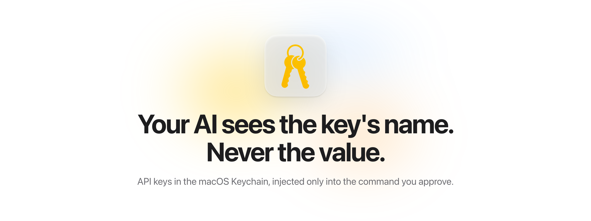
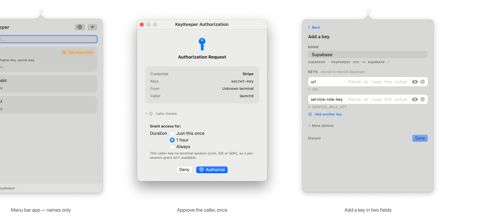
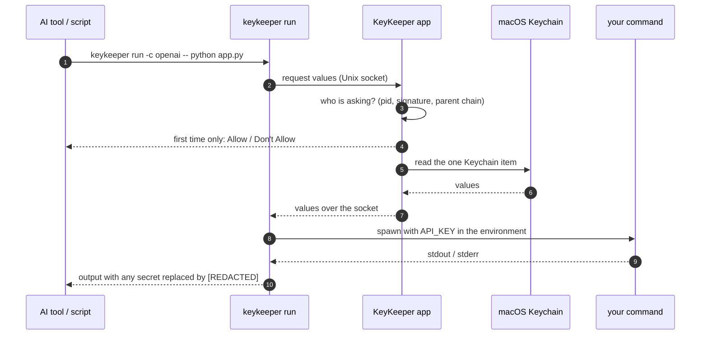

<p align="center">
  
</p>

<p align="center">
  <a href="https://keykeeper.dev"></a>
  <a href="https://github.com/IvyYang1999/KeyKeeper/blob/main/LICENSE"></a>
  
  
  <a href="https://github.com/IvyYang1999/KeyKeeper/stargazers"></a>
  <a href="https://github.com/IvyYang1999/KeyKeeper/commits/main"></a>
</p>

<p align="center">
  <b>English</b> · <a href="README.zh-CN.md">简体中文</a>
</p>

<p align="center">
  <a href="#quick-start">Quick start</a> ·
  <a href="#how-it-works">How it works</a> ·
  <a href="#why-not-just-env">Why not .env</a> ·
  <a href="#ai-tools">AI tools</a> ·
  <a href="#security-model">Security model</a> ·
  <a href="https://keykeeper.dev">keykeeper.dev</a>
</p>

---

**Trust agents to manage your API keys. Safely.** KeyKeeper is a small macOS menu bar app, a `keykeeper` CLI and two thin SDKs. API keys live in the **macOS Keychain**. Claude Code, Cursor, Copilot, cron jobs and scripts work with a key's **name**; `keykeeper run` puts the value only into the environment of the one command that needs it and masks exact matches in that command's output. A command you approve receives the real value, so an agent that runs commands can get it if it deliberately tries. [What KeyKeeper protects against, and what it doesn't](#what-keykeeper-protects-against-and-what-it-doesnt) says where the line is.

There is no master password, no vault to unlock, no `.env` to leak into git or chat. Logging into your Mac is the unlock.

<p align="center">
  
</p>

## Contents

**Docs: [keykeeper.dev/docs](https://keykeeper.dev/docs)** — getting started, approvals, provider templates, the security model, and the rules agents follow.


- [Quick start](#quick-start)
- [How it works](#how-it-works)
- [Why not just .env?](#why-not-just-env)
- [Everyday commands](#everyday-commands)
- [Who can use a key](#who-can-use-a-key)
- [AI tools](#ai-tools)
- [SDKs](#sdks)
- [Security model](#security-model)
- [Troubleshooting](#troubleshooting)
- [Project structure](#project-structure)
- [Roadmap](#roadmap)
- [Contributing](#contributing)

## Quick start

**Requirements:** macOS 14 or later.

Download the signed, notarized DMG from [GitHub Releases](https://github.com/IvyYang1999/KeyKeeper/releases/latest) or [keykeeper.dev](https://keykeeper.dev), drag **KeyKeeper** to Applications, and open it. The app updates itself with signed updates. There is no Homebrew cask yet.

1. **First run** — the setup screen installs the `keykeeper` CLI (it may ask for your password) and shows the command that installs the KeyKeeper plugin for Codex or Claude Code.
2. **Add a key** — click **+** in the menu bar window, type a name such as `OpenAI`, paste the value into `api-key`. The ID (`openai`) and the environment variable (`API_KEY`) are shown as you type.
3. **Use it** — run anything with the key injected into that process only:

   ```bash
   keykeeper run -c openai -- python script.py     # script reads os.environ["API_KEY"]
   keykeeper run -c openai -- claude               # key goes into claude's environment, not a file, shell history or chat
   ```

   If the program requires a different exact variable name, add the repeatable
   `--env <id>:<field>=<name>` mapping. Preview the complete mapping first with `--plan`.

That is the whole setup. No passphrase to choose, no recovery key to file away.

**Building from source (contributors):** requires the Xcode command line tools (`xcode-select --install`). A source build is ad-hoc signed and keeps its own separate data, so it is not the recommended way to install.

```bash
git clone https://github.com/IvyYang1999/KeyKeeper.git
cd KeyKeeper
./scripts/build-app.sh                       # dist/dmg/KeyKeeper.app + dist/KeyKeeper-<version>.dmg
cp -R dist/dmg/KeyKeeper.app /Applications/
open /Applications/KeyKeeper.app
```

## How it works



- **Store** — add a key in the app, or open a prefilled form with a `keykeeper://add?label=…&fields=…` link. Secret values go into one item in the macOS Data Protection Keychain, encrypted by macOS; values stay on this Mac unless you turn on iCloud sync. Names, notes, field names — and any field you mark plain — stay in a plain `meta.json`.
- **Use** — `keykeeper run -c <id> -- <command>` injects the secret fields as environment variables. `--env <id>:<field>=<name>` supplies an exact name when a program expects something different; `--plan` previews names, conflicts, local presence and access policy without returning values to the CLI or starting the command. The App checks local presence without showing an authorization prompt. Exact matches of a secret in the command's output are replaced with `[REDACTED]`. The app starts on demand.
- **Diagnose** — if the child command fails after injection, `run` reports its exit status and whether anything was injected. `--verbose` shows variable names, not values. Local presence and completed injection do not prove that the provider accepts the credential or the request.
- **Approve** — the first time a new app, terminal, script or agent asks for a key, KeyKeeper shows *who* is asking and lets you say yes once. Approvals are listed on the credential's page and can be revoked.
- **Reboot** — log in once after a boot and everything, cron jobs included, works again. Approved callers run without prompts in day-to-day use.

## Why not just .env?

|  | `.env` file | `envchain` | 1Password `op run` | Cloud secret manager | **KeyKeeper** |
|---|---|---|---|---|---|
| Where the value lives | Plain text in the project | macOS login Keychain | Your 1Password vaults (synced via 1Password) | Cloud provider's vault | macOS Keychain (optional encrypted iCloud sync) |
| What the AI tool sees | The value | Namespace names; the command receives the value | Secret references; the command receives the value | Secret names; the SDK or command receives the value | Key names; the approved command receives the value |
| Unlock | Nothing | Your Mac login, or the Keychain password every time if you set that | 1Password app (Touch ID or account password) or service-account token | Account + network | Your Mac login |
| Who may ask | Any process that can read the file | Any program that can run `envchain` | Whatever you authorize in the 1Password app, or any process holding a service-account token | Any process with credentials | **Each calling app, terminal or script, approved once** |
| Output redaction | No | No | Yes (by default) | No | Yes (exact matches; off with `--tty`) |
| Offline / cron | Yes | Yes, while the login Keychain is unlocked | Needs the 1Password app unlocked or a service-account token | Needs network | Yes, after first login |
| Cost | Free | Free, MIT | Paid 1Password plan | Paid | Free; source-available (FSL-1.1-MIT, MIT after 2 years) |
| Adding a key an agent needs | You paste the value into the file or the chat | You type the value at an `envchain --set` prompt | You add it in 1Password | You add it in the provider's console or CLI | The agent gives you a prefilled `keykeeper://add` link or a one-time local page; you paste the value, and it does not pass through the agent |

`envchain` is the closest tool: it also keeps values in the macOS Keychain and injects them into one command, but any program that can run `envchain` gets them, unless the item is set to ask for the Keychain password every time. KeyKeeper differs in the "Who may ask" row: there is no bearer token to copy, because it recognises the app, terminal or script a request was started from and asks you the first time. That boundary is per caller, not per command — an approval covers everything started inside that app or terminal. The other difference is the last row: when an agent needs a key it doesn't have, it gives you a prefilled `keykeeper://add` link or a one-time local page, and you paste the value there; it does not pass through the agent.

## Everyday commands

| Command | What it does |
|---|---|
| `keykeeper list` | IDs and labels |
| `keykeeper list --detail` | plus notes and field names (secrets shown as `********`) |
| `keykeeper meta <id>` | one credential as JSON, no values |
| `keykeeper providers` / `providers show <id>` | built-in provider contracts: official creation page, complete fields, least privilege and safe validation |
| `keykeeper run -c <id> [-c <id2>] [--env <id>:<field>=<name>] [--prefix PREFIX_] [--verbose] [--tty] -- <command>` | run a command with the keys injected; an explicit mapping replaces that field's derived and alias names |
| `keykeeper run -c <id> [mapping options] --plan` | preview final variable names, conflicts, local value presence and access policy; returns no secret values and starts no command |
| `keykeeper status` | is the app reachable (it starts on demand anyway) |
| `keykeeper grants list` / `grants revoke <id>` | approvals: which callers may use which keys or logins, for how long |
| `keykeeper requests list` | approval windows currently waiting |
| `keykeeper get <id> <field>` | used by the SDKs; refuses to print to a terminal unless `--reveal` |

`--tty` hands the command a real terminal (editors, TUIs, interactive agents); output redaction is off in that mode.

## Who can use a key

Every key group has one of two access modes, shown as a badge in the list:

| Badge | Meaning | Use it for |
|---|---|---|
| **Background OK** (default) | Scripts, cron jobs and agents can use the key after you approve each caller once. | Anything that runs unattended. |
| **Ask every time** | Every new terminal session must be approved in the KeyKeeper window while you are at the Mac. | Keys you only use by hand. |

On a new install, KeyKeeper asks before a new script or agent uses a "Background OK" key. The setting in **Settings** is called `Ask me before a new script or agent uses a "Background OK" key` and is on by default. Turning it off lets any process on the Mac read "Background OK" keys without asking, which is not recommended.

In **Settings** you can also turn on **Launch at Login**. While running, KeyKeeper checks for signed updates every six hours by default, downloads them in the background and installs them when you quit. If you keep the app open, it reminds you after a day. Turn off **Download updates in the background** to be asked before downloading. Explicit saved update preferences are preserved.

## AI tools

### Codex and Claude Code plugins

Open **Settings → AI tool integration**, choose your tool, and run its copied installation
command in Terminal. The App carries a self-contained plugin package; no checkout is needed.
Start a new conversation afterwards. Installing the plugin grants no credential access.
See the [installation and safety guide](Plugins/keykeeper/README.md) for updates/removal,
same-Mac requirements and developer installation. Existing standalone skills aren't overwritten.

The standalone skill below remains available for older installations. Prefer one active source
to avoid conflicting instructions; the plugin doesn't automatically remove existing skills.

### Claude Code

The [skill](skill/keykeeper.md) teaches Claude Code to discover credentials with `keykeeper list --detail`, run code through `keykeeper run`, offer a prefilled `keykeeper://add?…` link when a key is missing, and avoid asking for or printing values.

```bash
mkdir -p ~/.claude/skills/keykeeper
curl -fsSL https://raw.githubusercontent.com/IvyYang1999/KeyKeeper/main/skill/keykeeper.md \
  -o ~/.claude/skills/keykeeper/SKILL.md
```

Or paste the prompt shown on the setup screen into Claude Code and let it do this.

### Any other tool

Anything that can run a shell command can use KeyKeeper: `keykeeper run -c <id> -- <tool>`. When a key is missing, hand the user a link instead of asking them to retype names:

```
keykeeper://add?label=Stripe&fields=secret-key,publishable-key
```

## SDKs

New credentials are inject-only by default: they work with `keykeeper run` (and the SDKs' `run` / `runWithSecrets`), not with `keykeeper get` or the SDKs' `get_key` / `getKey`. To use `get_key` or `getKey`, switch on `Can be read out (keykeeper get, SDKs)` on that credential's page first.

```bash
pip install ./sdk-python
npm install ./sdk-node
```

```python
from keykeeper import get_key, list_credentials, run
api_key = get_key("openai", "api-key")           # value returned over a pipe
run("openai", ["python", "script.py"])           # same as keykeeper run
```

```javascript
const { getKey, runWithSecrets } = require('keykeeper');
const apiKey = await getKey("openai", "api-key");
runWithSecrets("openai", ["node", "server.js"]);
```

Both SDKs shell out to the `keykeeper` CLI; no native dependencies.

## Security model

| Layer | What happens |
|---|---|
| Values at rest | In the downloaded app, all secret values live in one item in the macOS Data Protection Keychain, in KeyKeeper's own access group. The item is marked "this device only": it is not part of iCloud Keychain and does not move to another Mac through Time Machine or Migration Assistant. It is available after the first unlock following a boot, so cron jobs work once you have logged in. Values stay on this Mac unless you turn on iCloud sync. Fields you mark *plain* are not secrets and stay in `meta.json` as plain text. |
| Unlocking | Your macOS login; there is no separate password. Values become available at the first unlock after a boot and stay available while the screen is locked. |
| Metadata | `meta.json` holds labels, notes and field *names* in plain text — plus the values of fields you explicitly marked plain (an account id, a team id, a region). Never put a password, token or key in a plain field. |
| Using a key | `keykeeper run` injects values into the child process's environment and replaces them with `[REDACTED]` in its stdout/stderr. `keykeeper get` refuses to print to a terminal. |
| Who may ask | Per-credential mode (Background OK / Ask every time) plus per-caller approvals, shown and revocable in the app. Concurrent requests queue up instead of failing. |
| Other apps | Only software signed with KeyKeeper's developer identity can read that Keychain item. Other programs cannot read it directly (there is no prompt to click through); they have to ask KeyKeeper. |
| Clipboard | Copying a value from the app marks it concealed for clipboard managers and clears it after 30 s unless you copied something else. |
| iCloud sync | Optional, off by default. Syncs keys and notes across your own Macs. The vault is encrypted on the Mac with AES-256-GCM before upload and stored in your private iCloud database. The encryption key is kept in iCloud Keychain, so iCloud Keychain must be on for a second Mac to read the data; without it, sync is not a backup. Approvals and saved website logins do not sync: each Mac approves its own callers. |
| Backup | There is no export yet (it stays on the [roadmap](#roadmap)). Values are bound to the device. With one Mac and iCloud sync off, a lost or erased Mac means the values are gone, so keep the ability to re-issue keys at the provider. |
| Network | Update checks against GitHub every six hours; everything else is opt-in (iCloud sync, provider check on save, optional reviewer model). No telemetry, analytics or crash reporting. See [What leaves your Mac](#what-leaves-your-mac) below. |

### What leaves your Mac

- **Updates:** an update check against GitHub every six hours, and the download of signed updates.
- **iCloud sync** *(optional, off by default)*: the encrypted vault, to your private iCloud database.
- **Provider check on save** *(only when you approve a save started with `keykeeper save --provider …` for a template that defines a check)*: one read-only verification request to that provider's own API, carrying that key. The approval window names the host.
- **Reviewer model** *(optional, off by default in Settings)*: the credential's name and field names, what you declared it is for, the caller, its stated reason and command line go to the model endpoint you configured. Values are not sent.
- **Nothing else:** no telemetry, analytics or crash reporting.

### What an approval actually covers

When you approve a request, this is the exact scope. Nothing here is inferred — it is what the code checks.

| Choice | Who it covers | Until |
|---|---|---|
| Just this once | Only the program that asked | That one run: each field it asked for is handed out once, within two minutes |
| While it runs | Only that program, in that terminal session; with no terminal session, for as long as that app or script process keeps running | The session or process ends — at most 24 hours for a terminal session, 7 days for a process |
| Don't ask again | Only the program that asked | You revoke it |

A caller KeyKeeper cannot identify is offered only *Just this once*, and is refused outright for *Ask every time* credentials.

Two things worth being precise about:

- **"Only the program that asked" is identified by where it came from**, not by a name it gives itself: the first ancestor process with a bundle identifier (so an agent you launched from Terminal is identified as Terminal), otherwise the path of the script or executable. An agent running inside an app is covered by that app's approval. KeyKeeper works this out from the running process tree when the request arrives. This tells apart the programs you use, but it does not stop malicious software already running under your macOS account from passing itself off as one of them (see below).
- **Which fields it covers depends on the credential's mode.** For an *Ask every time* credential, an approval covers every secret field of that credential. For a *Background OK* credential, it covers the fields that request asked for: `keykeeper run` asks for all of the credential's secret fields, `keykeeper get` for one. Split credentials you want to grant separately.

Website sessions use the same three durations and the same per-caller rule, and are stored the same way the login snapshots are — in the Keychain, not in a file. Their windows also end permission on a timer: the window freezes and cannot reach the network until you authorize again.

Approvals issued before KeyKeeper 0.3.4 recorded no caller. They are not carried over: the next time that caller asks, you are asked again. You can see and revoke every approval in the app.

### What KeyKeeper protects against, and what it doesn't

**Protects against:**

- Keys sitting in `.env` files and repos.
- Keys pasted into chats or AI context.
- Keys in shell history (the value is never typed into a command) and in logs (exact-match output masking).
- A tool reading a key silently. The first request from a new app, terminal or script shows who is asking, approving needs Touch ID or your Mac password, every approval is listed and revocable, and background reads are logged.

**Does not protect against:**

- **Malicious software running under your macOS account.** It can run commands inside an app you already approved, read the environment of a running command, or control the screen.
- **A command or agent you approved that deliberately extracts the value.** It receives the real value and can transform, save or send it. Output masking only catches the exact value, and `--tty` turns masking off.
- **Scope.** An approval is as wide as the caller: approving a terminal app covers everything run in that terminal, and a script is recognised by its path, not by its content.
- **Provider-side risk.** A leaked key still works at the provider: prefer scoped, low-privilege keys and rotate them.

KeyKeeper keeps keys out of the places they leak by accident; it is not a sandbox.

## Troubleshooting

### Import a key from an Agent's browser

Run `keykeeper save -c my-provider --field api_key --from-browser --create`. The CLI prints a one-time local receiver link: open it in the same browser session, paste, then confirm once in KeyKeeper. The key is not passed in command arguments or returned to the Agent. The receiver comes with the App, runs on each user's own Mac, and closes after the request; no hosted server or extension is needed.

Omit `--create` to restore an existing missing field. Values are never overwritten, and new credentials are strict with no read grants. `--from-clipboard` uses the macOS clipboard instead: website Copy buttons and browser-session clipboards can differ. Desktop/same-Mac only; see [usage and limitations](docs/BROWSER-IMPORT.md).


| You see | Do |
|---|---|
| `The KeyKeeper app could not be started` | Open KeyKeeper from Applications once; check it isn't blocked by Gatekeeper. |
| `This caller is not authorized` | Click Authorize in the KeyKeeper window, or set the credential to Background OK. `keykeeper grants list` shows approvals. |
| `Timed out … waiting for approval` | Run it again while you're at the Mac; approval windows wait 2 minutes. |
| Cron jobs fail right after a reboot | Log in once; jobs work from then on (the Keychain unlocks at your first login after a boot). |
| macOS asks about "confidential information" | Source builds only: you rebuilt KeyKeeper with a different signing identity. Click Always Allow once, or set a stable identity in `.signing-identity` (see `scripts/build-app.sh`). |
| `Refusing to print a secret to the terminal` | Use `keykeeper run`, or add `--reveal` if you really want it on screen. |
| Setup says the CLI is out of date | Click Update CLI (Settings › Command line) so CLI and app come from the same build. |

## Project structure

```
KeyKeeper/
├── Sources/
│   ├── KeyKeeperCore/   # Keychain blob store, metadata, grants, IPC protocol
│   ├── KeyKeeperCLI/    # keykeeper: list, get, meta, run, status, grants, requests, migrate-storage
│   └── KeyKeeperApp/    # menu bar app (SwiftUI): credentials, approvals, settings
├── sdk-python/          # Python SDK (wraps the CLI)
├── sdk-node/            # Node.js SDK (wraps the CLI)
├── skill/               # Claude Code skill
├── scripts/             # build-app.sh, install-cli.sh, git hooks
├── Tests/               # XCTest suites (swift test)
└── Package.swift
```

## Roadmap

- [ ] Homebrew cask
- [ ] Encrypted export / import for moving keys between Macs
- [x] Signed, notarized DMG on GitHub Releases
- [x] Optional encrypted iCloud sync
- [x] Chinese UI for the app (the website is already bilingual)
- [x] Signed in-app updates
- [x] Per-caller approval with process identity
- [x] `keykeeper://add` deep links for AI tools

## Contributing

1. Fork and branch: `git checkout -b my-feature`
2. Bug fixes come with a test first (`swift test` runs in the pre-commit hook).
3. Keep commits atomic and open a pull request with what changed and why.

Report security vulnerabilities privately; see [SECURITY.md](SECURITY.md).

## License

The app, CLI and core are under the [Functional Source License, Version 1.1, MIT Future License](LICENSE)
(FSL-1.1-MIT): the source is public, you may read, build, modify and use it for anything except
offering a competing product or service, and each version becomes plain MIT two years after its
release. The [Node SDK](sdk-node/LICENSE), [Python SDK](sdk-python/LICENSE), the
[agent skill](skill/LICENSE) and the [Codex / Claude Code plugin](Plugins/keykeeper/LICENSE) stay MIT,
so anything that talks to KeyKeeper can be embedded without a second thought. Releases up to 0.3.4
were published under MIT and remain so.
