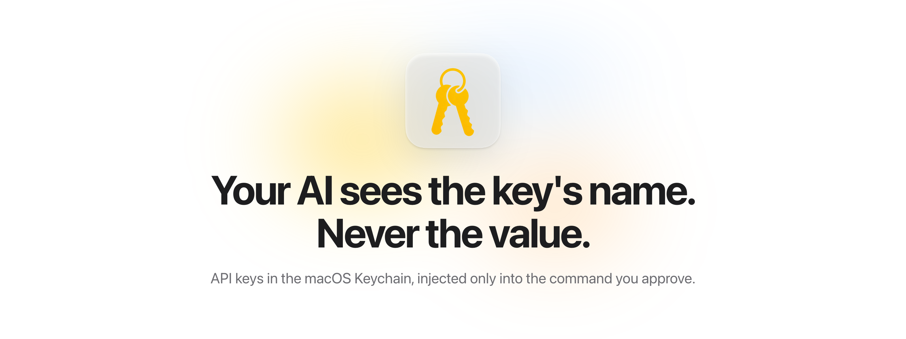
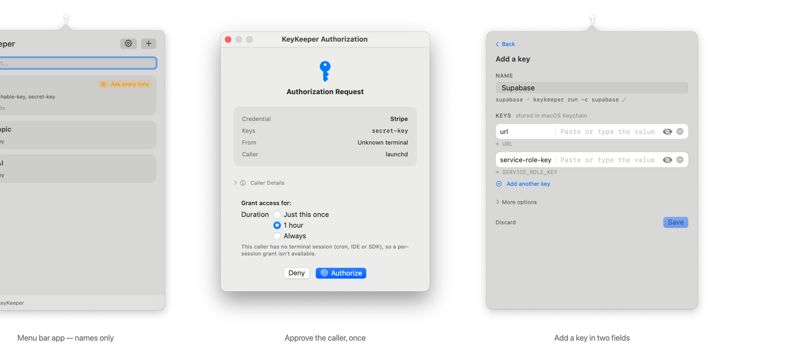
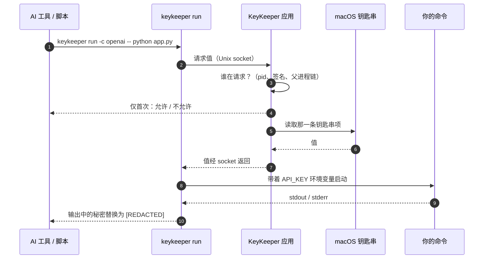

<p align="center">
  
</p>

<p align="center">
  <a href="https://keykeeper.dev"></a>
  <a href="https://github.com/IvyYang1999/KeyKeeper/blob/main/LICENSE"></a>
  
  
  <a href="https://github.com/IvyYang1999/KeyKeeper/stargazers"></a>
  <a href="https://github.com/IvyYang1999/KeyKeeper/commits/main"></a>
</p>

<p align="center">
  <a href="README.md">English</a> · <b>简体中文</b>
</p>

<p align="center">
  <a href="#快速开始">快速开始</a> ·
  <a href="#工作原理">工作原理</a> ·
  <a href="#为什么不直接用-env">为什么不直接用 .env</a> ·
  <a href="#ai-工具">AI 工具</a> ·
  <a href="#安全模型">安全模型</a> ·
  <a href="https://keykeeper.dev">keykeeper.dev</a>
</p>

---

**把 API Key 放心交给 Agent。** KeyKeeper 是一个小小的 macOS 菜单栏应用，外加 `keykeeper` 命令行和两个很薄的 SDK。API key 存在 **macOS 钥匙串**里。Claude Code、Cursor、Copilot、cron 任务和脚本按 key 的**名字**工作；`keykeeper run` 只把值放进真正需要它的那一条命令的环境变量，并把该命令输出里精确匹配的值脱敏。经你批准的命令会拿到真实的值，所以能执行命令的 Agent 如果有意提取，仍然拿得到。界线在哪，见 [KeyKeeper 防什么，不防什么](#keykeeper-防什么不防什么)。

没有主密码，没有要解锁的保险库，没有会泄漏进 git 或对话的 `.env`。登录 Mac 就是解锁。

<p align="center">
  
</p>

## 目录

**文档：[keykeeper.dev/docs](https://keykeeper.dev/docs)**（英文）——开始使用、授权、服务商模板、安全模型、给 Agent 的规则。


- [快速开始](#快速开始)
- [工作原理](#工作原理)
- [为什么不直接用 .env](#为什么不直接用-env)
- [常用命令](#常用命令)
- [谁能用这把 key](#谁能用这把-key)
- [AI 工具](#ai-工具)
- [SDK](#sdk)
- [安全模型](#安全模型)
- [排错](#排错)
- [项目结构](#项目结构)
- [路线图](#路线图)
- [参与贡献](#参与贡献)

## 快速开始

**要求：** macOS 14 或更高版本。

从 [GitHub Releases](https://github.com/IvyYang1999/KeyKeeper/releases/latest) 或 [keykeeper.dev](https://keykeeper.dev) 下载经过签名和公证的 DMG，把 **KeyKeeper** 拖进「应用程序」并打开。应用通过签名更新自动升级。目前还没有 Homebrew cask。

1. **首次运行** — 设置页会安装 `keykeeper` 命令行（可能会问一次密码），并给出一条命令，用来给 Codex 或 Claude Code 安装 KeyKeeper 插件。
2. **添加 key** — 在菜单栏窗口点 **+**，输入名字（比如 `OpenAI`），把值贴进 `api-key`。ID（`openai`）和环境变量名（`API_KEY`）会随着输入实时显示。
3. **用起来** — 任何命令都可以带着 key 跑，key 只注入到这个进程：

   ```bash
   keykeeper run -c openai -- python script.py     # 脚本读 os.environ["API_KEY"]
   keykeeper run -c openai -- claude               # 值进 claude 的环境变量，不进文件、shell 历史或对话
   ```

   如果程序要求另一个固定变量名，加上可重复的 `--env <id>:<字段>=<变量名>` 映射；
   先用 `--plan` 预览完整映射。

设置就这么多。不用想密码短语，不用收好恢复码。

**从源码构建（贡献者）：** 需要 Xcode 命令行工具（`xcode-select --install`）。源码构建使用临时签名（ad-hoc），且保存独立的数据，不推荐作为日常安装方式。

```bash
git clone https://github.com/IvyYang1999/KeyKeeper.git
cd KeyKeeper
./scripts/build-app.sh                       # 生成 dist/dmg/KeyKeeper.app 和 dist/KeyKeeper-<version>.dmg
cp -R dist/dmg/KeyKeeper.app /Applications/
open /Applications/KeyKeeper.app
```

## 工作原理



- **存** — 在应用里添加 key，或用 `keykeeper://add?label=…&fields=…` 链接打开预填好的表单。机密值存在 macOS 数据保护钥匙串的一个条目里，由 macOS 加密；除非开启 iCloud 同步，否则值留在这台 Mac 上。名字、备注、字段名，以及你标为明文的字段，都放在明文的 `meta.json` 里。
- **用** — `keykeeper run -c <id> -- <命令>` 把秘密字段注入为环境变量。程序要求另一个固定变量名时，用 `--env <id>:<字段>=<变量名>` 精确映射；`--plan` 由 App 无弹窗检查本地存储状态，向 CLI 只返回字段名和状态，不返回秘密值，也不启动业务命令。命令输出里精确匹配机密值的内容会被替换成 `[REDACTED]`。应用按需自动启动。
- **排查** — 子命令在注入后失败时，`run` 会说明退出状态和是否注入了值；`--verbose` 只显示变量名，不显示值。本地有值或完成注入，都不代表服务商接受这把凭据或这次请求。
- **批准** — 新的应用、终端、脚本或 agent 第一次请求某把 key 时，KeyKeeper 会显示*谁*在请求，你点一次允许即可。批准记录列在凭据页面上，可以撤销。
- **重启后** — 开机后登录一次，一切（包括 cron）就恢复工作。已批准的调用方日常使用不再弹窗。

## 为什么不直接用 .env

|  | `.env` 文件 | `envchain` | 1Password `op run` | 云端密钥管理 | **KeyKeeper** |
|---|---|---|---|---|---|
| 值放在哪 | 项目里的明文 | macOS 登录钥匙串 | 1Password 保险库（经 1Password 同步） | 云服务商的保险库 | macOS 钥匙串（可选加密 iCloud 同步） |
| AI 工具看到什么 | 值 | 命名空间名；命令拿到值 | 密钥引用；命令拿到值 | 密钥名；SDK 或命令拿到值 | 密钥名；经批准的命令拿到值 |
| 解锁 | 无 | 你的 Mac 登录；也可设成每次输入钥匙串密码 | 1Password 应用（触控 ID 或账号密码）或服务账号 token | 账号 + 网络 | 你的 Mac 登录 |
| 谁能请求 | 能读文件的任何进程 | 任何能运行 `envchain` 的程序 | 你在 1Password 应用里授权过的程序，或任何持有服务账号 token 的进程 | 持有凭据的任何进程 | **每个调用应用、终端或脚本，批准一次** |
| 输出脱敏 | 无 | 无 | 有（默认开启） | 无 | 有（精确匹配；`--tty` 关闭） |
| 离线 / cron | 可以 | 可以，只要登录钥匙串已解锁 | 需要 1Password 应用已解锁或服务账号 token | 需要网络 | 首次登录后即可 |
| 价格 | 免费 | 免费，MIT | 需付费 1Password 订阅 | 付费 | 免费；源码可用（FSL-1.1-MIT，发布两年后转 MIT） |
| 添加 Agent 缺的 key | 你把值粘贴进文件或聊天 | 你在 `envchain --set` 的提示下输入值 | 你在 1Password 里添加 | 你在服务商控制台或 CLI 里添加 | Agent 给你一个预填好的 `keykeeper://add` 链接或一次性本机页面；你粘贴值，值不经过 Agent |

最接近的工具是 `envchain`：它同样把值存在 macOS 钥匙串里、只注入一条命令，但除非把条目设成每次都要钥匙串密码，否则任何能运行 `envchain` 的程序都能拿到值。KeyKeeper 的不同在「谁能请求」这一行：没有需要四处复制的访问令牌，它会识别请求是从哪个应用、终端或脚本发起的，并在首次请求时问你。这个边界按调用方划分，而不是按单条命令——批准某个应用或终端后，在里面启动的进程都会被覆盖。另一个不同在最后一行：Agent 缺一把 key 时，会给你一个预填好的 `keykeeper://add` 链接或一次性本机页面，你在那里粘贴值，值不经过 Agent。

## 常用命令

| 命令 | 作用 |
|---|---|
| `keykeeper list` | ID 和名字 |
| `keykeeper list --detail` | 外加备注和字段名（秘密显示为 `********`） |
| `keykeeper meta <id>` | 一条凭据的 JSON，不含值 |
| `keykeeper providers` / `providers show <id>` | 内置的服务商模板：官方创建页面、完整字段、最小权限和安全的校验方式 |
| `keykeeper run -c <id> [-c <id2>] [--env <id>:<字段>=<变量名>] [--prefix PREFIX_] [--verbose] [--tty] -- <命令>` | 带着 key 运行命令；显式映射会替代该字段自动推导的变量名和旧名 |
| `keykeeper run -c <id> [映射选项] --plan` | 预览最终变量名、冲突、本地存储状态和授权策略；不向 CLI 返回秘密值，也不启动命令 |
| `keykeeper status` | 应用是否可达（反正它会按需启动） |
| `keykeeper grants list` / `grants revoke <id>` | 授权：哪些调用方可以用哪些 key 或登录态、多久 |
| `keykeeper requests list` | 正在等待的授权窗口 |
| `keykeeper get <id> <field>` | 给 SDK 用；除非加 `--reveal`，否则拒绝打印到终端 |

`--tty` 把真实终端交给命令（编辑器、TUI、交互式 agent 需要）；这种模式下不做输出脱敏。

## 谁能用这把 key

每组 key 有两种访问模式之一，在列表里以徽标显示：

| 徽标 | 含义 | 适合 |
|---|---|---|
| **允许后台使用**（Background OK，默认） | 脚本、cron 和 agent 在你批准每个调用方一次之后就能使用。 | 任何无人值守的东西。 |
| **每次询问**（Ask every time） | 每个新的终端会话都要你在 Mac 前、在 KeyKeeper 窗口里批准。 | 只手动使用的 key。 |

新安装的 KeyKeeper 会在新脚本或 Agent 首次使用「允许后台使用」的凭据前询问你。**设置**里的对应选项是 「新脚本或 Agent 使用“允许后台使用”的密钥前，先询问我」，默认开启。关闭后，这台 Mac 上的任何进程都可以不经询问读取「允许后台使用」的凭据，不建议关闭。

在**设置**里也可以打开**登录时启动**。KeyKeeper 运行时默认每 6 小时检查一次签名更新，在后台下载、退出时安装；一直不退出时，一天后会提醒。关闭**在后台下载更新**后，下载前会询问你。已经保存的更新偏好会保留。

## AI 工具

### Codex / Claude Code 插件（推荐）

在 **设置 → AI 工具接入** 选择工具，将安装命令复制到终端运行，再新建对话。
插件包随 App 附带，不需要下载源码，仅支持同一台 Mac。安装插件不会自动授予密钥权限。
详见[安装、更新与卸载说明](Plugins/keykeeper/README.md)。

以下独立 skill 继续兼容旧版安装。插件不会覆盖或自动移除已有 skill；确认插件可用后，
建议只保留一个生效来源，避免规则冲突。

### Claude Code

[技能文件](skill/keykeeper.md)教会 Claude Code 用 `keykeeper list --detail` 发现凭据、通过 `keykeeper run` 跑代码、缺 key 时给出预填好的 `keykeeper://add?…` 链接，并且不索要、不打印值。

```bash
mkdir -p ~/.claude/skills/keykeeper
curl -fsSL https://raw.githubusercontent.com/IvyYang1999/KeyKeeper/main/skill/keykeeper.md \
  -o ~/.claude/skills/keykeeper/SKILL.md
```

或者把设置页上那句提示粘给 Claude Code，让它自己装。

### 其它任何工具

只要能跑 shell 命令就能用 KeyKeeper：`keykeeper run -c <id> -- <工具>`。缺 key 的时候，递给用户一个链接，而不是让他们手动重打名字：

```
keykeeper://add?label=Stripe&fields=secret-key,publishable-key
```

## SDK

新建的凭据默认仅允许注入：可以通过 `keykeeper run`（以及 SDK 的 `run` / `runWithSecrets`）使用，不能用 `keykeeper get` 或 SDK 的 `get_key` / `getKey` 直接读取。要使用 `get_key` 或 `getKey`，需先在该凭据页面打开 「允许读出（keykeeper get、SDK）」。

```bash
pip install ./sdk-python
npm install ./sdk-node
```

```python
from keykeeper import get_key, list_credentials, run
api_key = get_key("openai", "api-key")           # 值通过管道返回
run("openai", ["python", "script.py"])           # 等同于 keykeeper run
```

```javascript
const { getKey, runWithSecrets } = require('keykeeper');
const apiKey = await getKey("openai", "api-key");
runWithSecrets("openai", ["node", "server.js"]);
```

两个 SDK 都是调用 `keykeeper` 命令行，没有原生依赖。

## 安全模型

| 层 | 发生什么 |
|---|---|
| 静态存储 | 在下载版应用中，所有机密值存在 macOS 数据保护钥匙串（Data Protection Keychain）的一个条目里，归属 KeyKeeper 自己的访问组。该项标记为「仅限此设备」：不会进入 iCloud 钥匙串，也不会通过时间机器或迁移助理迁移到另一台 Mac。开机首次解锁后即可访问，所以登录一次后 cron 任务就能正常运行。除非开启 iCloud 同步，否则值留在这台 Mac 上。你标为*明文*的字段不是机密，仍以明文存在 `meta.json` 里。 |
| 解锁 | 你的 macOS 登录，没有另外的密码。开机后第一次解锁起值就可用，锁屏期间仍然可用。 |
| 元数据 | `meta.json` 明文存放名字、备注、字段*名*，以及你主动标为明文的那些字段的值（账号 ID、团队 ID、区域这类）。明文字段里绝不要放密码、令牌或密钥。 |
| 使用 key | `keykeeper run` 把值注入子进程环境，并把 stdout/stderr 里出现的值替换为 `[REDACTED]`。`keykeeper get` 拒绝打印到终端。 |
| 谁能请求 | 每条凭据的模式（允许后台使用 / 每次询问）加上每个调用方的批准，都在应用里可见、可撤销。并发请求排队而不是失败。 |
| 其它应用 | 只有用 KeyKeeper 开发者身份签名的软件才能读取该钥匙串项。其它程序无法直接读取（也没有可以点过去的确认弹窗），只能向 KeyKeeper 请求。 |
| 剪贴板 | 从应用里复制值会标记为对剪贴板管理器隐藏，30 秒后自动清除（除非你又复制了别的）。 |
| iCloud 同步 | 可选功能，默认关闭。在你的多台 Mac 之间同步密钥和备注。保险库上传前在 Mac 本地用 AES-256-GCM 加密，存入你的私有 iCloud 数据库。加密密钥保存在 iCloud 钥匙串中，第二台 Mac 必须开启 iCloud 钥匙串才能读取数据；未开启时，同步不能充当备份。批准记录和已保存的网站登录态不同步：每台 Mac 各自批准自己的调用方。 |
| 备份 | 目前还没有导出功能（仍在[路线图](#路线图)上）。密钥值与设备绑定。如果只有一台 Mac 且未开启 iCloud 同步，Mac 丢失或抹掉后值就会丢失，请保留在服务商重新签发密钥的能力。 |
| 网络 | 每 6 小时向 GitHub 检查一次更新；其余网络请求均为可选（iCloud 同步、保存时的服务商校验、可选审核模型）。没有遥测、分析或崩溃上报。详见下方[哪些数据会离开你的 Mac](#哪些数据会离开你的-mac)。 |

### 哪些数据会离开你的 Mac

- **更新：** 每 6 小时向 GitHub 检查一次更新，以及下载签名更新包。
- **iCloud 同步**（可选，默认关闭）：加密后的保险库，存入你的私有 iCloud 数据库。
- **保存时的服务商校验**（仅当你批准了通过 `keykeeper save --provider …` 发起的保存，且对应模板定义了校验时）：向该服务商自己的 API 发一次只读验证请求，携带这把密钥。批准窗口会写明目标主机。
- **审核模型**（可选，在设置中默认关闭）：凭据名称和字段名、你登记的用途、调用方、它填写的原因和命令行，发往你配置的模型接口。不会发送密钥值。
- **没有其它上报：** 没有遥测、分析或崩溃上报。

### 一次批准到底允许了什么

你点「允许」之后的确切范围。下面不是推断，是代码真正检查的东西。

| 选项 | 允许了谁 | 到什么时候 |
|---|---|---|
| 仅本次 | 只有发起请求的那个程序 | 只管这一次运行：它请求的每个字段给一次，两分钟内有效 |
| 这次运行期间 | 只有那个程序，且在那个终端会话里；没有终端会话时，只在那个 App 或脚本进程还在运行期间 | 会话或进程结束为止；终端会话最长 24 小时，进程最长 7 天 |
| 以后都不问 | 只有发起请求的那个程序 | 直到你撤销 |

KeyKeeper 认不出身份的调用方只能选「仅本次」；对「每次询问」的凭据会直接拒绝。

有两点需要说准：

- **「那个程序」是按它从哪儿来认的**，不是按它自报的名字：取进程链上第一个有 bundle 标识的祖先（所以你从终端启动的 Agent，认出来是终端本身），否则取脚本或可执行文件的路径。跑在某个 App 里面的 Agent，被那个 App 的批准覆盖。KeyKeeper 在收到请求时根据正在运行的进程树判断来源。这能把你用的各个程序区分开，但挡不住已经在你的 macOS 账号下运行的恶意软件冒充其中某一个（见下文）。
- **覆盖哪些字段，看凭据的模式。**「每次询问」的凭据，一次批准覆盖这条凭据的全部机密字段。「允许后台使用」的凭据，只覆盖这次请求要的字段：`keykeeper run` 要的是这条凭据的全部机密字段，`keykeeper get` 只要一个。想分开授权就拆成不同凭据。

网站登录态用同样的三档时长、同样的「只认这个调用方」规则，存放方式也和登录态快照一样——在钥匙串里，不在文件里。它的窗口还会按时结束权限：到点冻结，重新授权之前连不上网络。

KeyKeeper 0.3.4 之前发出的批准没有记录调用方，升级时不会保留：那个调用方下次再请求时，会重新问你。所有批准都能在应用里看到和撤销。

### KeyKeeper 防什么，不防什么

**防什么：**

- 留在 `.env` 文件和代码库里的密钥。
- 贴进对话或 AI 上下文里的密钥。
- 落进 shell 历史的密钥（值从不出现在命令里）和落进日志的密钥（精确匹配的输出脱敏）。
- 工具悄悄读取密钥。新应用、终端或脚本首次请求时会显示是谁在问，批准需要触控 ID 或 Mac 密码，所有批准都会列出且可撤销，后台读取也有日志记录。

**不防什么：**

- **运行在你当前 macOS 账号下的恶意软件。** 它可以在你已批准的应用里跑命令、读取正在运行的命令的环境变量，或控制屏幕。
- **已获批准、但有意提取密钥的命令或 Agent。** 它拿到的是真实的值，可以变换、保存或发走。输出脱敏只拦精确匹配的值，`--tty` 模式会关闭脱敏。
- **批准范围。** 批准和调用方一样宽：批准一个终端应用会覆盖该终端里运行的所有命令；脚本按路径识别，不按内容识别。
- **服务商侧风险。** 泄露出去的密钥在服务商那里依然有效：尽量用权限受限的密钥，并定期轮换。

KeyKeeper 把密钥挡在容易意外泄露的地方之外；它不是沙箱。

## 排错

### 从 Agent 的浏览器导入密钥

运行 `keykeeper save -c my-provider --field api_key --from-browser --create`。CLI 会给出一个一次性本机接收链接：在同一浏览器会话里打开、粘贴，再到 KeyKeeper 确认一次。密钥不放进命令参数，也不返回给 Agent。接收功能随 App 安装，在每位用户自己的 Mac 上运行，请求结束后关闭；不需要云服务器或浏览器扩展。

去掉 `--create` 可补回已有凭据的缺失字段。不会覆盖已有值；新凭据默认每次询问，不授予读取权限。`--from-clipboard` 则读取 macOS 系统剪贴板——官网复制按钮和浏览器独立剪贴板可能使用不同来源。当前支持同一台 Mac 上的桌面 Agent，不支持远端云 Agent。详见[使用方法与限制](docs/BROWSER-IMPORT.md)。


| 你看到 | 怎么办 |
|---|---|
| `The KeyKeeper app could not be started` | 从「应用程序」打开一次 KeyKeeper；检查是否被 Gatekeeper 拦住。 |
| `This caller is not authorized` | 在 KeyKeeper 窗口点 Authorize，或把凭据设为「允许后台使用」。`keykeeper grants list` 能看到批准记录。 |
| `Timed out … waiting for approval` | 人在 Mac 前的时候再跑一次；授权窗口等 2 分钟。 |
| 重启后 cron 立刻失败 | 登录一次即可（开机后第一次登录时钥匙串解锁）。 |
| macOS 问「机密信息」 | 仅源码构建会遇到：你用另一个签名身份重新构建了 KeyKeeper。点一次 Always Allow，或在 `.signing-identity` 里固定一个身份（见 `scripts/build-app.sh`）。 |
| `Refusing to print a secret to the terminal` | 用 `keykeeper run`；真要显示在屏幕上就加 `--reveal`。 |
| 设置页说 CLI 过期 | 点 Update CLI（设置 › Command line），让 CLI 和应用来自同一次构建。 |

## 项目结构

```
KeyKeeper/
├── Sources/
│   ├── KeyKeeperCore/   # 钥匙串 blob 存储、元数据、授权记录、IPC 协议
│   ├── KeyKeeperCLI/    # keykeeper：list, get, meta, run, status, grants, requests, migrate-storage
│   └── KeyKeeperApp/    # 菜单栏应用（SwiftUI）：凭据、授权、设置
├── sdk-python/          # Python SDK（包装 CLI）
├── sdk-node/            # Node.js SDK（包装 CLI）
├── skill/               # Claude Code 技能
├── scripts/             # build-app.sh、install-cli.sh、git hooks
├── Tests/               # XCTest（swift test）
└── Package.swift
```

## 路线图

- [ ] Homebrew cask
- [ ] 加密导出 / 导入，用于在 Mac 之间迁移 key
- [x] GitHub Releases 上的签名、公证 DMG
- [x] 可选的加密 iCloud 同步
- [x] 应用界面中文（官网已经是双语）
- [x] 签名的应用内更新
- [x] 基于进程身份的逐调用方批准
- [x] 给 AI 工具用的 `keykeeper://add` 深链

## 参与贡献

1. Fork 并开分支：`git checkout -b my-feature`
2. 修 bug 先写测试（pre-commit hook 会跑 `swift test`）。
3. 提交保持原子，PR 里写清改了什么、为什么。

如发现安全漏洞，请私下报告，详见 [SECURITY.md](SECURITY.md)。

## 许可

App、CLI 和核心库采用 [Functional Source License 1.1（MIT 未来许可）](LICENSE)（FSL-1.1-MIT）：源码公开，
可以看、编译、修改、随便用，唯独不能拿去做竞争性的产品或服务；每个版本发布两年后自动变成普通 MIT。
[Node SDK](sdk-node/LICENSE)、[Python SDK](sdk-python/LICENSE)、[Agent skill](skill/LICENSE) 和
[Codex / Claude Code 插件](Plugins/keykeeper/LICENSE) 保持 MIT，接 KeyKeeper 的代码随便嵌。0.3.4 及之前的版本按 MIT 发布，不变。
